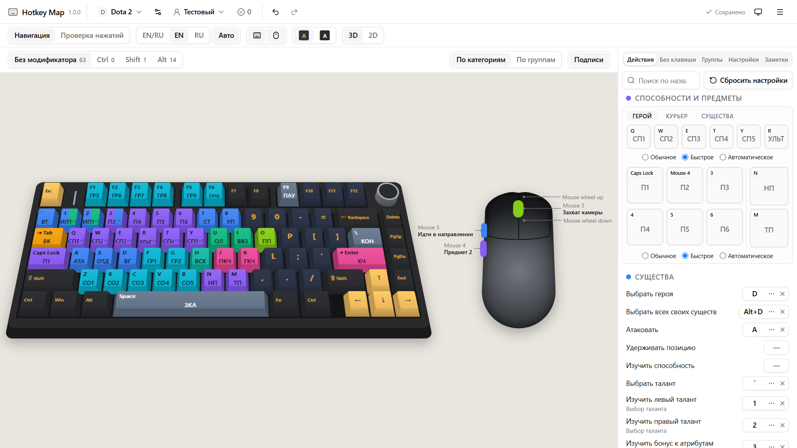

# Hotkey Map

**[Русский](#русский) · [English](#english)**

<picture>
  <source media="(prefers-color-scheme: dark)" srcset="docs/images/main-3d-dark.png">
  
</picture>

**Открыть приложение / Open the app:** https://dmitrii-a-piskunov.github.io/hotkey-map/

---

## Русский

Веб-приложение, которое показывает игровые бинды на объёмной экранной копии клавиатуры и мыши. Бинды и настройки хранятся по играм и профилям игроков в папке на вашем компьютере. Видно, какая клавиша за что отвечает, где конфликты и какие действия остались без клавиши.

Сервера нет: всё работает в браузере, данные не покидают ваш компьютер. Интерфейс на русском.

### Текущий этап

Вышла **версия 1.0.0** (MVP): все обязательные требования ТЗ сделаны, ручная проверка перед выпуском пройдена. Приложение можно использовать каждый день. Дальше — версия 1.1 и этап 2 (см. «Что планируется»).

### Что уже можно делать

**Клавиатура и мышь**

- Объёмная клавиатура AULA F75 (75% ANSI, 80 клавиш) и мышь с двумя боковыми кнопками; можно переключиться на плоский 2D-вид.
- На клавишах — короткие подписи действий и цвет категории или группы клавиш.
- Подписи клавиш на английском, русском или на обоих языках; две расцветки клавиатуры: «Стандартная» и «Чёрная».
- Два режима ввода: «Навигация» (выделение и правка) и «Проверка нажатий» (нажмите настоящую клавишу — она подсветится на экране).

**Игры и профили**

- Игры с контекстами (например, «Герой», «Курьер», «В транспорте»), категориями с цветом, действиями, параметром бинда (например, режим каста в Dota 2) и шаблоном настроек.
- Иконка игры подтягивается по ярлыку Steam.
- Несколько профилей игроков в одной игре: бинды, комбинации с Ctrl / Shift / Alt, значения настроек с ползунками, заметки. Профиль можно дублировать.
- Заготовки Dota 2 и PUBG: готовый список действий и настроек.

**Работа с биндами**

- Выделение клавиш как в проводнике: клик, Ctrl+клик, Shift+клик, рамка, стрелки, Ctrl+A.
- Слои модификаторов: отдельно видно, что висит на Ctrl, Shift и Alt.
- Группы клавиш и окраска по категориям или по группам.
- Конфликты и нарушения правил игры с учётом контекстов.
- Поиск действия и список действий без клавиши.
- Отмена и повтор (50 шагов).

**Данные**

- Хранение в выбранной папке (`data.json`, `icons/`, `backups/`), автосохранение и 5 автоматических резервных копий с восстановлением.
- Импорт и экспорт в `*.hotkeymap.json`: всё, одна игра или один профиль. При импорте — предпросмотр совпадений и выбор: слить, добавить копией или заменить.
- Светлая, тёмная и системная темы.
- Устанавливается как PWA и работает без интернета после первой загрузки.

### Браузеры

- **Chrome или Edge** — полный режим: данные лежат в папке на диске.
- **Firefox** — запасной режим: данные хранятся в браузере (IndexedDB). Регулярно делайте экспорт — приложение напомнит через 7 дней. Известное ограничение: Firefox не даёт странице отменить «Назад» / «Вперёд» по боковым кнопкам мыши.

Открывайте приложение в одной вкладке: вторая откроется только для просмотра.

### Как пользоваться

1. Откройте приложение и выберите пустую папку для данных (Chrome, Edge). Приложение предложит заготовки Dota 2 и PUBG.
2. Выберите игру и профиль в шапке. Выделите клавишу на экране или нажмите настоящую и назначьте действие в панели справа.
3. **Меню (☰) → Экспорт** сохраняет в файл всё, текущую игру или текущий профиль. **Меню → Импорт…** или перетаскивание файла в окно загружает его обратно с предпросмотром.
4. **Меню → Настройки…** — смена папки данных, восстановление резервной копии, версия.

### Что планируется

**Версия 1.1**

- Сравнение двух профилей.
- Выбор раскладки клавиатуры из списка.
- Сверка заготовок Dota 2 и PUBG с актуальными меню игр.

**Этап 2** (идеи, подробно не проработаны)

- Аккаунты и облачное хранение: настройки не теряются при смене ПК.
- Импорт и экспорт настоящих конфигов игр, в первую очередь Dota 2 и PUBG.
- Определение подключённой клавиатуры и библиотека раскладок (60%, 75%, TKL, полноразмерные, ANSI и ISO).
- Настоящая 3D-модель на Three.js.
- При необходимости — версия для Windows на Tauri.

### Разработка

Нужны Node.js 24 и npm.

```bash
npm install        # зависимости
npm run dev        # dev-сервер, http://localhost:5173
npm run build      # сборка в dist/
npm run preview    # просмотр сборки, http://localhost:4173/hotkey-map/
npm run lint       # ESLint
npm run typecheck  # проверка типов TypeScript
npm test           # модульные тесты и тесты компонентов (Vitest)
npm run e2e        # сквозные тесты в Chromium и Firefox (Playwright)
npm run e2e:pwa    # сборка, затем проверка service worker и офлайн-режима
npm run perf       # скорость выделения, см. docs/perf-selection.md
npm run screenshots # скриншоты для README в docs/images/
```

Для e2e-тестов dev-сборка понимает `?storage=browser`: данные хранятся в IndexedDB даже в Chrome, потому что Playwright не умеет работать с системным окном выбора папки. Собранная версия этот параметр игнорирует.

Для разработки берите отдельную папку данных: dev-сервер и GitHub Pages — разные сайты, у каждого своё разрешение на папку.

### Сборка и публикация

`npm run build` складывает статические файлы в `dist/` с базовым путём `/hotkey-map/`. Каждый push в `main` запускает в GitHub Actions lint, проверку форматирования, проверку типов, модульные тесты и сборку, затем публикует `dist/` на GitHub Pages. Другие ветки и pull request'ы проходят те же проверки без публикации.

Иконки приложения создаются из `public/icon.svg` командой `npm run pwa-assets`.

### Стек

TypeScript, React, Vite, Zustand + zundo, Tailwind CSS, shadcn/ui (Radix UI), Zod, vite-plugin-pwa, Vitest, Testing Library, Playwright.

### Документация

- [`docs/TZ.md`](docs/TZ.md) — техническое задание
- [`docs/manual-checklist.md`](docs/manual-checklist.md) — чек-лист ручной проверки перед выпуском
- [`docs/perf-selection.md`](docs/perf-selection.md) — замеры скорости выделения

### Лицензия

[MIT](LICENSE)

---

## English

A web app that shows your game keybinds on a 3D on-screen copy of your keyboard and mouse. Binds and settings are stored per game and per player profile in a folder on your computer. You can see what each key does, where binds conflict and which actions have no key yet.

There is no server: everything runs in the browser, and your data never leaves your computer. The interface is in Russian.

### Current stage

**Version 1.0.0** (MVP) is out: all required features from the spec are done, and the release checklist has passed. The app is ready for everyday use. Next up are version 1.1 and stage 2 (see “Roadmap”).

### What you can do now

**Keyboard and mouse**

- 3D keyboard AULA F75 (75% ANSI, 80 keys) and a mouse with two side buttons; a flat 2D view is available too.
- Keys show short action labels and the color of the category or key group.
- Key legends in English, Russian or both; two keyboard color schemes: Standard and Black.
- Two input modes: Navigation (select and edit) and Key test (press a real key and it lights up on the screen).

**Games and profiles**

- Games with contexts (for example Hero, Courier, In vehicle), colored categories, actions, a bind parameter (for example cast mode in Dota 2) and a settings template.
- The game icon is fetched from a Steam shortcut.
- Several player profiles per game: binds, combos with Ctrl / Shift / Alt, settings with sliders, notes. Profiles can be duplicated.
- Presets for Dota 2 and PUBG with ready-made actions and settings.

**Working with binds**

- Explorer-style key selection: click, Ctrl+click, Shift+click, marquee, arrow keys, Ctrl+A.
- Modifier layers: see separately what is bound with Ctrl, Shift and Alt.
- Key groups, and coloring by category or by group.
- Conflicts and game rule violations that respect contexts.
- Action search and a list of actions without a key.
- Undo and redo (50 steps).

**Data**

- Storage in a folder you choose (`data.json`, `icons/`, `backups/`), autosave and 5 automatic backups you can restore.
- Import and export to `*.hotkeymap.json`: everything, one game or one profile. Import shows a preview of what matches and lets you merge, add as a copy or replace.
- Light, dark and system themes.
- Installable as a PWA, works offline after the first load.

### Browsers

- **Chrome or Edge**: full mode, data lives in a folder on your disk.
- **Firefox**: fallback mode, data lives in the browser (IndexedDB). Export regularly; the app reminds you after 7 days. Known limit: Firefox does not let a page cancel Back / Forward on the side mouse buttons.

Open the app in one tab: a second tab opens view-only.

### Using it

1. Open the app and choose an empty folder for your data (Chrome, Edge). The app offers the Dota 2 and PUBG presets.
2. Pick a game and a profile in the header. Select a key on the screen or press a real key, then assign an action in the panel on the right.
3. **Menu (☰) → Export** saves everything, the current game or the current profile to a file. **Menu → Import…** or dropping a file onto the window brings it back, with a preview.
4. **Menu → Settings…** changes the data folder, restores a backup and shows the version.

### Roadmap

**Version 1.1**

- Compare two profiles.
- Choose the keyboard layout from a list.
- Check the Dota 2 and PUBG presets against the current in-game menus.

**Stage 2** (ideas, not worked out in detail)

- Accounts and cloud storage, so settings survive a new PC.
- Import and export of real game config files, starting with Dota 2 and PUBG.
- Detecting the connected keyboard, and a library of layouts (60%, 75%, TKL, full-size, ANSI and ISO).
- A real 3D model with Three.js.
- If needed, a Windows app built with Tauri.

### Development

Requirements: Node.js 24, npm.

```bash
npm install        # dependencies
npm run dev        # dev server, http://localhost:5173
npm run build      # production build into dist/
npm run preview    # serve the build, http://localhost:4173/hotkey-map/
npm run lint       # ESLint
npm run typecheck  # TypeScript
npm test           # unit and component tests (Vitest)
npm run e2e        # end-to-end tests in Chromium and Firefox (Playwright)
npm run e2e:pwa    # build, then check the service worker and offline mode
npm run perf       # selection speed, see docs/perf-selection.md
npm run screenshots # README screenshots into docs/images/
```

For e2e tests the dev build accepts `?storage=browser`: it keeps data in IndexedDB even in Chrome, because Playwright cannot use the system folder picker. The production build ignores it.

Use a separate data folder for development: the dev server and GitHub Pages are different sites, and each has its own folder permission.

### Build and deploy

`npm run build` writes static files to `dist/` with the base path `/hotkey-map/`. Every push to `main` runs lint, format check, type check, unit tests and the build in GitHub Actions, then publishes `dist/` to GitHub Pages. Other branches and pull requests run the same checks without deploying.

App icons are generated from `public/icon.svg` with `npm run pwa-assets`.

### Tech stack

TypeScript, React, Vite, Zustand + zundo, Tailwind CSS, shadcn/ui (Radix UI), Zod, vite-plugin-pwa, Vitest, Testing Library, Playwright.

### Documentation

- [`docs/TZ.md`](docs/TZ.md): requirements (in Russian)
- [`docs/manual-checklist.md`](docs/manual-checklist.md): release checklist
- [`docs/perf-selection.md`](docs/perf-selection.md): selection speed measurements

### License

[MIT](LICENSE)
